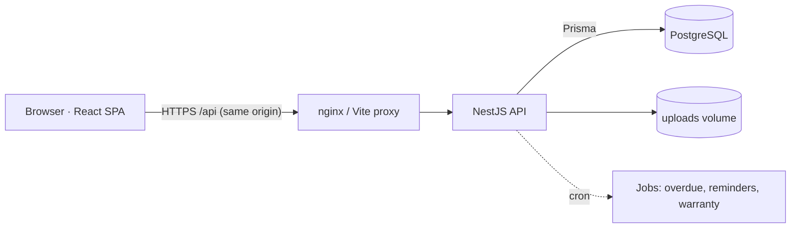

# Architecture

IDAS Inventory & Resource Management System is a **modular monolith**: one NestJS API, one React SPA, one PostgreSQL database.
No microservices – the scale (a single lab) does not justify the operational cost, and module boundaries are kept clean so a module could be split out later.



## Backend modules (`backend/src`)
| Module | Responsibility |
|---|---|
| `auth` | login, JWT access token (15 min), rotating refresh token (httpOnly cookie, stored hashed), lockout, password change |
| `users`, `lookups` | users, roles/permissions views, departments, categories, locations, settings |
| `assets` | asset register, field-level history, versioned specifications, movements, QR, documents, soft-archive |
| `loans` | request → approval → issue → return → inspection, overdue & due-soon jobs |
| `bookings` | lab slots, availability engine, approval, reservations, calendar |
| `maintenance` | repair workflow with verification gate; damage and lost/missing reports |
| `stocktakes` | snapshot, per-asset results, completion consequences |
| `reports` | 18 reports, JSON / CSV / XLSX / PDF export |
| `dashboard` | statistics, per-user summary, scheduled jobs |
| `notifications` | in-app notifications (email channel hook: `Notification.emailedAt`) |
| `audit` | append-only hash-chained audit log |
| `common` | permission matrix, guards, decorators, exception filter, helpers |

Layering: **controller** (HTTP, DTO validation, `@RequirePermissions`) → **service** (business rules, transactions) → **Prisma** (data access).
Controllers contain no business logic.

## Frontend (`frontend/src`)
React 18 + TypeScript + Vite + Tailwind 4 + shadcn/ui primitives, React Router, TanStack Query (server state), React Hook Form + Zod.
`lib/api.ts` keeps the access token in memory, refreshes it transparently on 401, and the refresh token lives in an httpOnly cookie (unreadable by JavaScript).
`components/common.tsx` holds the shared loading / error / empty states, data table (sorting, pagination), confirm dialogs and form field.

## Request pipeline
`ThrottlerGuard` → `JwtAuthGuard` (valid token, active user) → `PermissionsGuard` (all `@RequirePermissions` codes) → `ValidationPipe` (whitelist, reject unknown fields) → controller → service → `AllExceptionsFilter` (consistent JSON errors, Prisma error mapping).

## Project structure
```
idas-inventory-system/
├── backend/            NestJS API, Prisma schema, migrations, seed, unit + API tests
│   ├── prisma/         schema.prisma, migrations/, seed.ts
│   └── src/            one folder per module
├── frontend/           React SPA (+ vitest unit tests)
├── database/tools/     generator used to produce the initial SQL migration
├── tests/              Playwright browser tests
├── docs/               technical documentation
├── .github/workflows/  CI
├── .devcontainer/      GitHub Codespaces / VS Code dev container
└── docker-compose.yml  production-style stack
```
