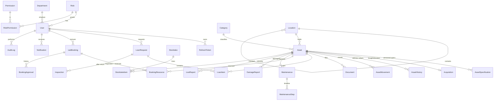

# Database design

PostgreSQL 16, managed by Prisma. Schema: `backend/prisma/schema.prisma`. Migrations: `backend/prisma/migrations/`.

29 tables. Required entities map as follows: Users/Roles/Permissions/Departments/Locations/Assets/Categories/Specifications/Acquisitions/AssetMovements/Loans(`LoanRequest`)/LoanItems/Inspections/LabBookings/BookingResources/Maintenance/DamageReports/LostReports/Stocktakes/Notifications/Documents/AuditLogs exist as tables of the same name. **Repairs** are the repair fields of `Maintenance` (+ `MaintenanceStep` timeline) and **Reservations** are `BookingResource` rows with `reserved = true` (concrete assets held by an approved booking) — see design-decisions.md.

## Integrity rules enforced by the database itself
Defined in migration `…_db_guards` (cannot be expressed in the Prisma schema):

| Rule | Mechanism |
|---|---|
| Audit log is append-only | `BEFORE UPDATE/DELETE` and `BEFORE TRUNCATE` triggers raise an exception |
| Asset change history is append-only | same trigger on `AssetHistory` |
| No two **approved** lab bookings overlap | `EXCLUDE USING gist (tsrange(startTime,endTime) WITH &&) WHERE status='APPROVED'` |
| Sane values | CHECK constraints: end > start, quantities > 0, cost ≥ 0, warranty end ≥ start |
| A repair cannot be `VERIFIED` without a passed test, verifier and timestamp | CHECK `maint_verified_needs_pass` |
| Unique IDs | unique indexes on asset tag, serial number, reference numbers, user email/university ID |
| Referential integrity | foreign keys everywhere; no cascading deletes of business records |

Soft deletion is used only for assets (`isArchived`) and users (`isActive`). Everything else is retained forever.

## Reference numbers
`LN-0001` (loans), `BK-0001` (bookings), `MT-0001` (maintenance), `DM-0001` (damage), `LS-0001` (lost), `ST-0001` (stocktake) and asset tags `IDAS-<CATEGORY>-0001` come from counters in the `Setting` table, serialised with a transaction-scoped advisory lock so concurrent requests never get the same number.
